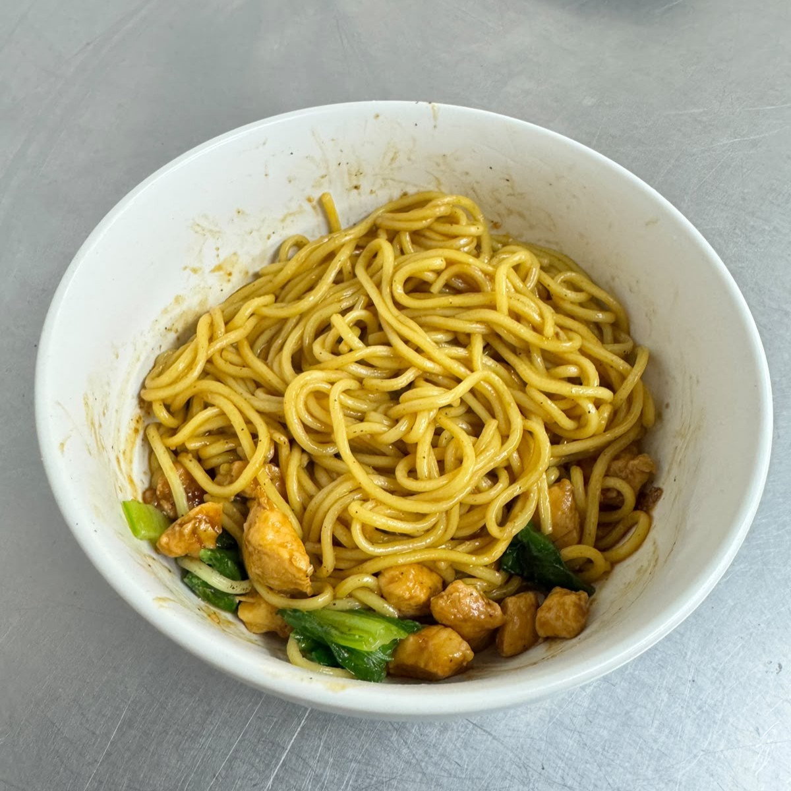

1. Sauté garlic and ginger until golden brown.
2. Cook diced chicken in the garlic & ginger oil with oyster sauce, kecap manis, salt, and mushroom stock to taste.
3. When cooked, mix well with the noodles along with soy sauce and black pepper.

